```{r}
#| label: setup
#| include: false
source('analysis/run_analysis.R')
source('analysis/report_helpers.R')
library(dplyr)
library(tidyr)
library(knitr)
library(sf)
d <- readRDS('outputs/prepared.rds')
s <- readRDS('outputs/statistics.rds')
f <- readRDS('outputs/figure_data.rds')
e <- readRDS('outputs/extensions.rds')
h <- readRDS('outputs/evidence_audit.rds')
severity_validation <- readRDS('outputs/severity_validation.rds')
global_moran <- readRDS('outputs/global_moran.rds')
g <- d$townships
fmt <- function(x) format(x,big.mark=',',scientific=FALSE,trim=TRUE)
fmt_p <- function(x) ifelse(x<.001,'<0.001',sprintf('%.3f',x))
places <- function(ids,n=4) {
  z<-st_drop_geometry(g)[match(head(ids,n),g$TS_PCODE),]
  if(!nrow(z))return('none')
  paste(paste0(z$TS,' (',z$ST,')'),collapse='; ')
}
```

# Research question and scope

Where do recorded armed-conflict events and reported fatalities cluster across Myanmar townships, and how did local concentrations evolve between January 2021 and September 2025?

The analysis distinguishes **absolute burden**, **spatial association**, and **temporal change in clustering**. A large count does not by itself establish a statistically significant hotspot. A hotspot does not establish why violence occurred. The intended use is retrospective peace-building and humanitarian situational awareness at township level, not targeting, tactical planning, or individual risk prediction.

This report follows the [Take-home Exercise 2 brief](https://isss626-ay2026-27aug.netlify.app/take-home_ex02). The companion [executive summary](executive_summary.qmd) presents the central findings. All outputs below derive from the supplied data rather than textbook example numbers.

# Data and study design

## Sources and variables

| Input | Role | Version and coverage |
|---|---|---|
| `data/Aspatial/ACLED_Data_Myanmar_Jan2021-Sep2025.csv` | Local ACLED extract for the course exercise | 1 January 2021 to 30 September 2025 |
| `data/Geospatial/mmr_polbnda_adm3_250k_mimu_1.shp` and companions | Township boundaries obtained through MIMU GeoNode | 330 unique township P-codes; embedded `PCode_V` is 9.4 |

The CSV contains violent and non-violent event types. The primary operational definition retains **Battles**, **Explosions/Remote violence**, and **Violence against civilians** within Myanmar. Protests, riots and strategic developments are excluded. This is an armed-conflict subset, not every event in ACLED's broader political-violence category. The latter can include specific protest and riot subtypes. See the [ACLED Codebook](https://acleddata.com/methodology/acled-codebook).

Two outcomes are analysed: the number of retained records and the sum of their reported fatalities. Fatalities represent recorded estimates, not an independently verified death toll. No population denominator is supplied, so neither outcome estimates per-capita risk. A zero bin means no retained record in this extract; it does not prove the absence of violence or complete reporting.

The boundary download request is preserved in `data/Geospatial/wfsrequest.txt`. The local file confirms the required version through its attributes. The source does not independently establish that every boundary reflects conditions in every study month. No download date is inferred from a file modification timestamp.

The course brief identifies eLearn as the distribution channel for its ACLED dataset. This report records the supplied filename and input fingerprint, but the local CSV alone does not verify its acquisition channel or download date. These provenance details require the original download record. The three retained event categories operationalise armed conflict consistently throughout the analysis.

## Data-quality checks and spatial assignment

The preparation script checks IDs, dates, coordinates, non-negative fatalities, boundary validity and township identifiers. It repairs geometries if necessary and transforms both polygons and points to a WGS84 Albers equal-area CRS centred on Myanmar. Coordinates are assigned through polygon intersection rather than joining potentially ambiguous township names. Repeated place names remain distinct through their P-codes.

```{r}
#| label: quality-table
kable(d$quality$audit,col.names=c('Check or processing stage','Records / units'),format.args=list(big.mark=','))
```

There are `r nrow(d$unassigned)` unassigned eligible records, all within one kilometre of the boundary. The primary analysis excludes these rather than silently snapping them. A sensitivity analysis assigns only these near-boundary records to their nearest polygon. Raw data remain unchanged. The main panel contains **`r fmt(nrow(d$assigned))` events** and **`r fmt(sum(d$assigned$fatalities))` reported fatalities**.

```{r}
kable(d$quality$precision,col.names=c('Geographic precision code','Temporal precision code','Assigned records'))
```

Geographic precision is not a distance-error estimate. The precise-location-only sensitivity retains code 1 and compares results with the full analysis. Among matched records, `r d$quality$name_check$missing_admin3` lack `admin3`; `r d$quality$name_check$exact_name_disagreement` have a township name that differs under a simple case-insensitive comparison. These flags can reflect transliteration, coding or location discrepancies. They are not automatically treated as incorrect spatial matches. Temporal precision limitations remain relevant even after monthly aggregation.

## Resolving the township-name flags

The initial string comparison is a screening device. Removing punctuation and spaces resolves **522** of the **530** non-missing name flags. A further **four** records use `Pangsang`, the primary name in the boundary label `Pangsang (Panghkam)`, within the same state. These are compatible labels, not demonstrated changes of township. **Four** records instead name a different, uniquely identified township in the same state. The **107** missing names remain a separate quality category. These classifications use only the supplied boundary names and state labels; no fuzzy spelling match or unsupported external crosswalk is used.

```{r}
kable(h$audit_summary,col.names=c('Diagnosis','Records','Reported fatalities'))
kable(h$name_pairs %>% mutate(admin3=replace_na(admin3,'[missing]')),
 col.names=c('ACLED state','ACLED township','Polygon state','Polygon township','Diagnosis','Records'))
```

The conflicting coordinates fall in Twantay rather than the label Kawhmu (two records), Pinlaung rather than Pekon (one), and Ann rather than Toungup (one). Distance below is from the recorded point to the labelled alternative polygon, not to a town centre. Proximity can indicate boundary or coding uncertainty but cannot determine which field is correct. Coordinates retain priority in the main analysis; alternate assignments are tested rather than written into the raw data.

```{r}
kable(h$conflicts %>% select(admin3,name,region,records,fatalities,minimum_km,maximum_km,precise_records),digits=3,
 col.names=c('Recorded label','Spatial match','State/region','Records','Fatalities','Min distance km','Max distance km','Precision-1 records'))
```

### Does the uncertainty change the static findings?

Three checks exclude the **111** unresolved/missing-name records, exclude all **637** initial flags (including harmless formatting differences), or assign the four conflicting records to their uniquely matched labels. Each check recomputes both outcomes with the original weights, seeds and 4,999 permutations. This is a targeted diagnostic of label uncertainty; it does not establish the correct location of an individual incident.

```{r}
kable(h$audit_counts,col.names=c('Scenario','Retained records','Excluded','Reassigned'))
kable(h$audit_stability,digits=3,
 col.names=c('Scenario','Outcome','Baseline BH hot','Alternative BH hot','Retained','Gained','Lost','Jaccard','BH LISA changes'))
```

All three scenarios retain the same **23 event** and **27 fatality** positive Gi* townships after BH adjustment. Their hotspot-set Jaccard similarity is **1.000**. The separate LISA-change column prevents hotspot agreement from being mistaken for agreement on every local statistic. This materially narrows the original concern: the flagged names do not drive these adjusted static hotspot sets. It does not validate every input record or establish EHSA robustness to reassignments. Aggregate diagnostics are saved without incident IDs, coordinates or narrative notes.

## A complete monthly space-time cube

The panel is the Cartesian product of 330 townships and 57 months: **18,810 bins**. A left join of observed aggregates followed by explicit zero-filling prevents inactive townships or months from disappearing. Assertions reconcile panel totals with the matched input records. The study ends in September 2025; full-year totals for 2025 would not be comparable with earlier full years.

```{r}
kable(head(d$panel,8),col.names=c('Township P-code','Month','Events','Reported fatalities'))
```

# Descriptive geography

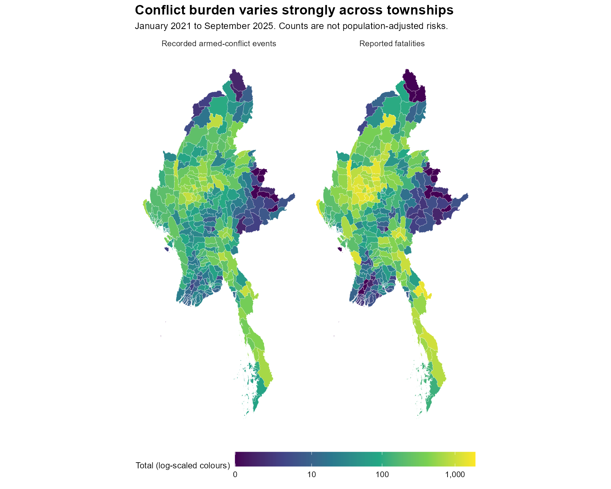{#fig-burden}

Recorded burden is uneven. `r places(g$TS_PCODE[order(-g$events)],3)` have the largest event totals. The maps use a logarithmic colour transformation to show lower-count areas alongside large totals; the underlying counts are untransformed. Differences between event and fatality distributions can arise from the severity and composition of recorded incidents. These maps describe burden without testing clustering or controlling for population, land area, access or reporting intensity.

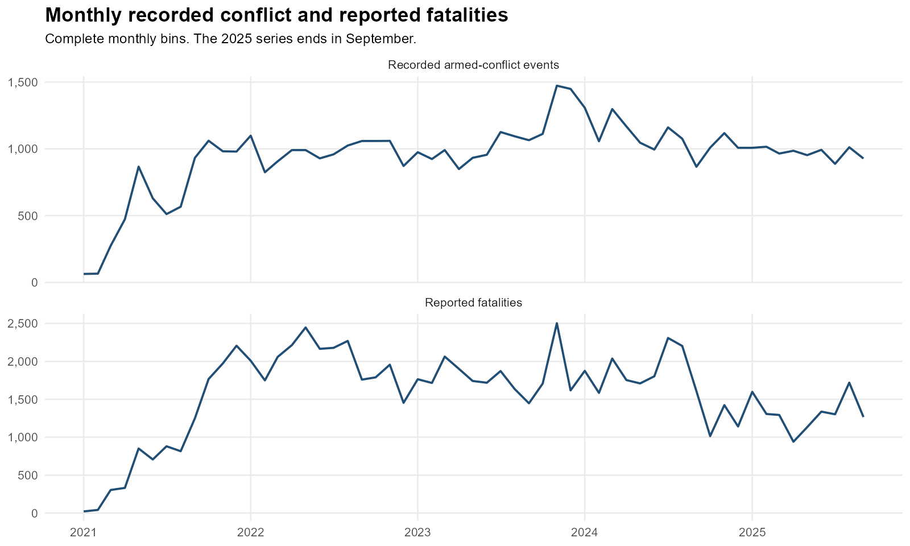{#fig-monthly}

The peak event month is **`r format_month_en(f$monthly$month[which.max(f$monthly$events)])`**, with `r fmt(max(f$monthly$events))` records. The peak reported-fatality month is **`r format_month_en(f$monthly$month[which.max(f$monthly$fatalities)])`**. The separate axes avoid treating different units as interchangeable. National changes can affect a space-time statistic with a pooled temporal reference, so township trend findings require comparison with this common temporal context.

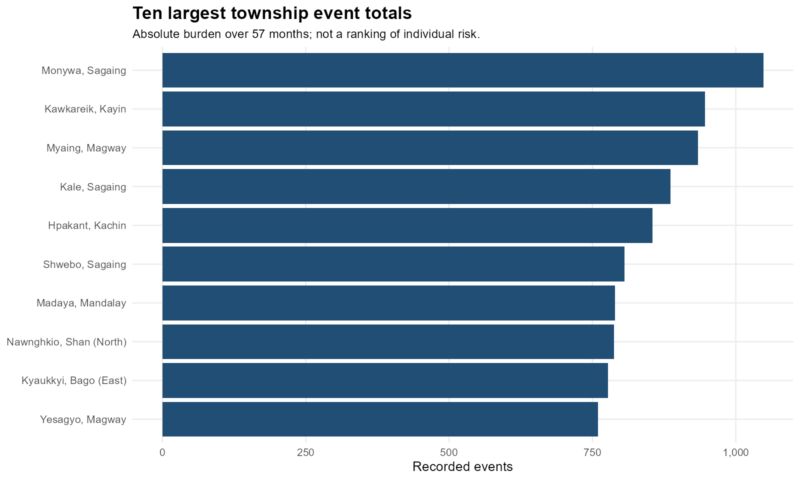{#fig-top}

The ranking identifies places contributing most to the recorded national burden. It is useful for selecting case studies for contextual review, but does not rank residents' risk. A township can have a large total without being surrounded by similarly high-count neighbours; Local Moran's I below separates those situations.

# Spatial weights and inference

Queen contiguity represents shared boundaries or vertices, with a ten-metre tolerance after projection. Local Moran's I excludes the focal township; Gi* includes it. Row-standardised weights give each neighbourhood total weight one. A township with no queen neighbour receives a reciprocal link to its nearest representative point so it can participate in analysis. This exception is explicit and does not imply a transport connection across water.

```{r}
kable(data.frame(Measure=c('Minimum analysis neighbours','Median analysis neighbours','Maximum analysis neighbours','Queen isolates repaired','Original connected components','Analysis connected components'),Value=c(min(s$weights$analysis_neighbours),median(s$weights$analysis_neighbours),max(s$weights$analysis_neighbours),sum(s$weights$isolate_link_added),s$queen_components,s$analysis_components)))
```

Different graph components are retained rather than joined arbitrarily. Conditional permutations still use the national reference distribution. A symmetric six-nearest-neighbour graph provides a sensitivity check. Neither graph is a causal model of conflict diffusion.

Static tests use 4,999 conditional permutations and two-sided simulation p-values, a fixed seed and one core. Their null concerns spatial arrangement conditional on observed values and the selected neighbourhood. Local Moran categories combine the test with the signs of the centred focal value and spatial lag. Gi* uses self-including weights. The [spdep documentation](https://r-spatial.github.io/spdep/reference/localG.html) specifies this distinction.

Main maps colour only tests with **p < 0.05**, as requested. Grey polygons supply context, not a significant class. Benjamini-Hochberg (BH) adjusted values are reported separately for each outcome and test family. Spatial dependence and heavy-tailed counts limit simple inferential interpretations; significance is exploratory, not a causal or predictive guarantee.

Thin state/region outlines and selected labels on the main LMSA and EHSA maps provide geographic reference. These labels are not statistical findings and do not change the township unit of analysis. The case locator and neighbourhood maps identify the more detailed areas discussed later.

## Global context and Moran scatterplots

This supplementary step adapts the Global Moran's I workflow in [Hands-on Exercise 5(1)](../../Hands-on_Ex/Hands-on_Ex05/Hands-on_Ex0501.qmd) and the centred scatterplot in [Hands-on Exercise 5(2)](../../Hands-on_Ex/Hands-on_Ex05/Hands-on_Ex0502.qmd), based on the course's [Chapter 9](https://r4gdsa.netlify.app/chap09.html) and [Chapter 10](https://r4gdsa.netlify.app/chap10.html). Hunan GDPPC is replaced by the two Myanmar township totals. The existing queen-based graph, isolate repairs, township order and row standardisation are retained; the focal township is excluded.

The null randomly reallocates the observed totals across the fixed national graph. Each outcome uses 9,999 permutations and a fixed seed, with the null statistics generated by [moran.mc](https://r-spatial.github.io/spdep/reference/moran.mc.html). To avoid a zero simulated p-value, the reported two-sided p is twice the smaller inclusive tail probability, capped at one; each tail is (1 + number of equally or more extreme simulations) / 10,000. This explicit finite-simulation convention replaces the function's returned p-value. Holm adjustment covers these **two global tests only**, separately from the existing local BH families. Under random allocation the expected I is -1/329, not exactly zero. This is a supplementary overall check, not a prerequisite for local analysis or a replacement for EHSA.

```{r}
#| label: global-moran-table
global_table <- global_moran$results %>%
  transmute(Outcome=ifelse(variable=='events','Event counts','Reported fatalities'),
            `Moran I`=round(I,4),`Null expectation`=round(null_expectation,4),
            `Permutation p`=sprintf('%.4f',permutation_p),
            `Holm p (2 tests)`=sprintf('%.4f',holm_p),Permutations=permutations)
kable(global_table)
```

Both outcomes show positive overall spatial association at the two-test Holm 0.05 threshold. The larger fatality I does not establish a statistically tested difference between outcomes. Population, reporting coverage and other spatial heterogeneity can violate the national exchangeability assumption; these are count-based associations, not per-capita risks or causal effects.

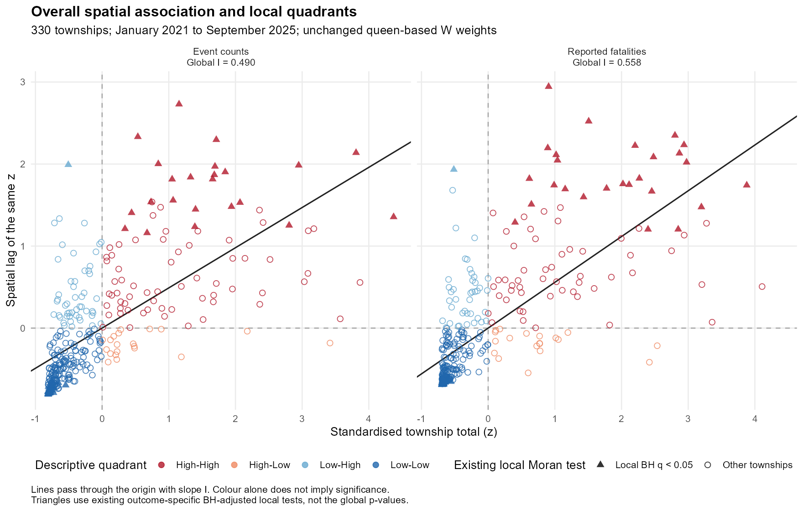{#fig-global-moran}

Each point is a township. The axes show its standardised total and the neighbour average of **the same standardised variable**. The line through the origin has slope I because the weights sum to 330. Colours distinguish descriptive quadrants; triangles identify existing local Moran BH q < 0.05 results. Quadrant membership alone does not establish significance. Both panels use the same axis scales and raw totals before standardisation.

### Sensitivity to skewness and spatial weights

For each outcome, a two-by-two comparison crosses raw totals and `log1p(total)` with the original queen graph and a symmetric six-nearest-neighbour graph. The latter uses the same projected representative points as the existing local sensitivity analysis. Symmetrisation retains an edge selected by either township, so final degrees can exceed six. All graphs exclude self-neighbours and use row-standardised weights. The transformation retains zeros and reduces the influence of large totals, but changes the measured variable and does not adjust for population or reporting.

Each setting uses 9,999 permutations and the same outcome-specific seed. Holm adjustment jointly covers **all eight outcome/setting tests**, including the two original raw/queen tests. The earlier two-test adjusted values remain labelled separately; none is substituted into local or EHSA results.

```{r}
#| label: global-moran-sensitivity
global_sensitivity <- global_moran$sensitivity
kable(global_sensitivity %>%
  transmute(Outcome=ifelse(variable=='events','Events','Fatalities'),
            Weights=graph,Scale=transform,`Moran I`=round(I,3),
            `Permutation p`=sprintf('%.4f',permutation_p),
            `Holm p (8 tests)`=sprintf('%.4f',holm_p_8)))
```

```{r}
#| echo: false
#| results: asis
cat(sprintf('Positive association remains supported in %s of %s settings after eight-test Holm adjustment. ',
            sum(global_sensitivity$positive_supported),nrow(global_sensitivity)))
for(v in c('events','fatalities')) {
  a <- global_sensitivity %>% filter(variable==v)
  cat(sprintf('%s I ranges from %.3f to %.3f. ',if(v=='events')'Event-count' else 'Fatality',min(a$I),max(a$I)))
}
```

The direction and significance survive reduced count skewness and an alternative graph. Magnitudes change, so they should not be treated as directly comparable effect sizes across scales or weights. These related checks are not independent replications, do not prove that extreme observations have no influence, and do not validate local or temporal classifications. All eight simulated p-values reach the doubled-tail floor of 0.0002; the common adjusted value of 0.0016 reflects simulation resolution, not identical strength of evidence.

# Local measures of spatial association

## Event counts

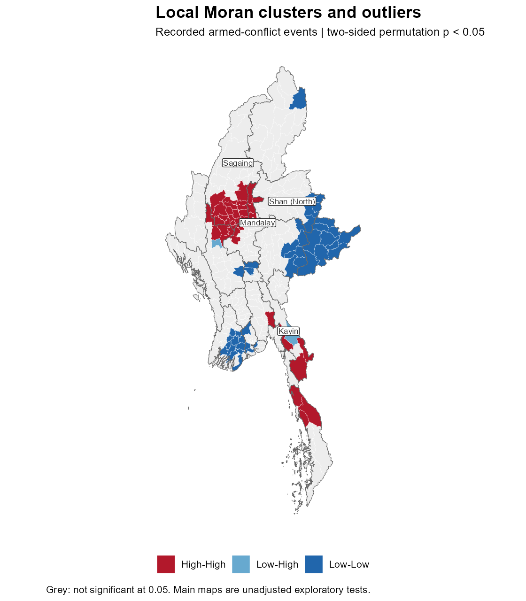{#fig-events-lisa}

```{r}
#| results: asis
#| echo: false
z<-s$static %>% filter(variable=='events')
cat(sprintf('At unadjusted p < 0.05, %s townships form High-High clusters, %s Low-Low clusters, %s High-Low outliers and %s Low-High outliers. High-High examples include %s. These categories compare a township with its neighbours, not with its own past. Low-Low clusters may reflect low recorded activity or weaker observation; they do not establish safety.',sum(z$lisa=='High-High'),sum(z$lisa=='Low-Low'),sum(z$lisa=='High-Low'),sum(z$lisa=='Low-High'),places(z$code[z$lisa=='High-High'],3)))
```

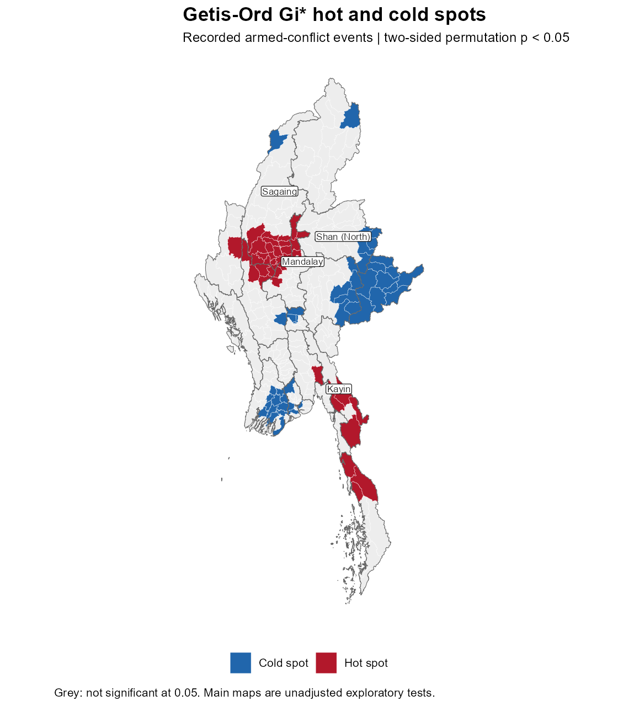{#fig-events-gi}

```{r}
#| results: asis
#| echo: false
cat(sprintf('The Gi* test identifies %s hot-spot and %s cold-spot townships at p < 0.05. It measures local concentrations including the focal area, whereas Moran\'s I distinguishes clusters from outliers. These two maps therefore answer related but different questions. A significant hotspot supports unusually high local recorded burden under this reference model, not an explanation of its causes.',sum(z$hotspot=='Hot spot'),sum(z$hotspot=='Cold spot')))
event_regions<-tibble(region=g$ST[match(z$code[z$hotspot=='Hot spot'],g$TS_PCODE)]) %>% count(region,sort=TRUE)
cat(sprintf(' The largest regional concentration is %s, containing %s of these nominal event-count hot spots.',event_regions$region[1],event_regions$n[1]))
```

## Reported fatalities

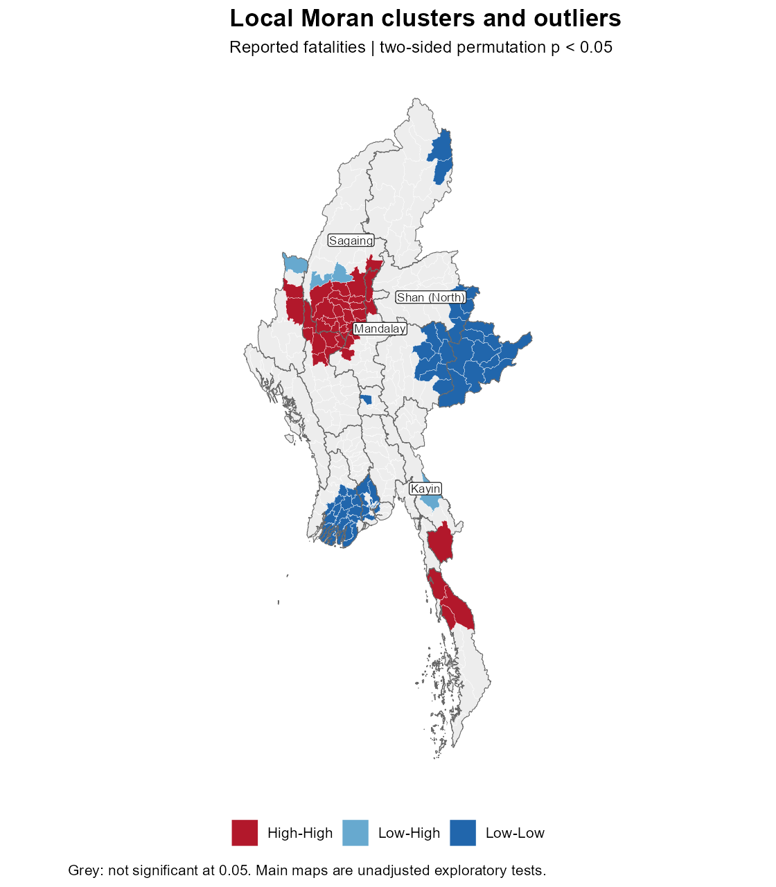{#fig-fatalities-lisa}

```{r}
#| results: asis
#| echo: false
zf<-s$static %>% filter(variable=='fatalities')
cat(sprintf('Reported fatalities produce %s High-High clusters and %s High-Low outliers at p < 0.05. High-High examples include %s. Fatality-based association need not reproduce event-count association: a small number of severe incidents can strongly affect the sum. Uncertain fatality reporting and differences in incident severity are therefore central limitations.',sum(zf$lisa=='High-High'),sum(zf$lisa=='High-Low'),places(zf$code[zf$lisa=='High-High'],3)))
```

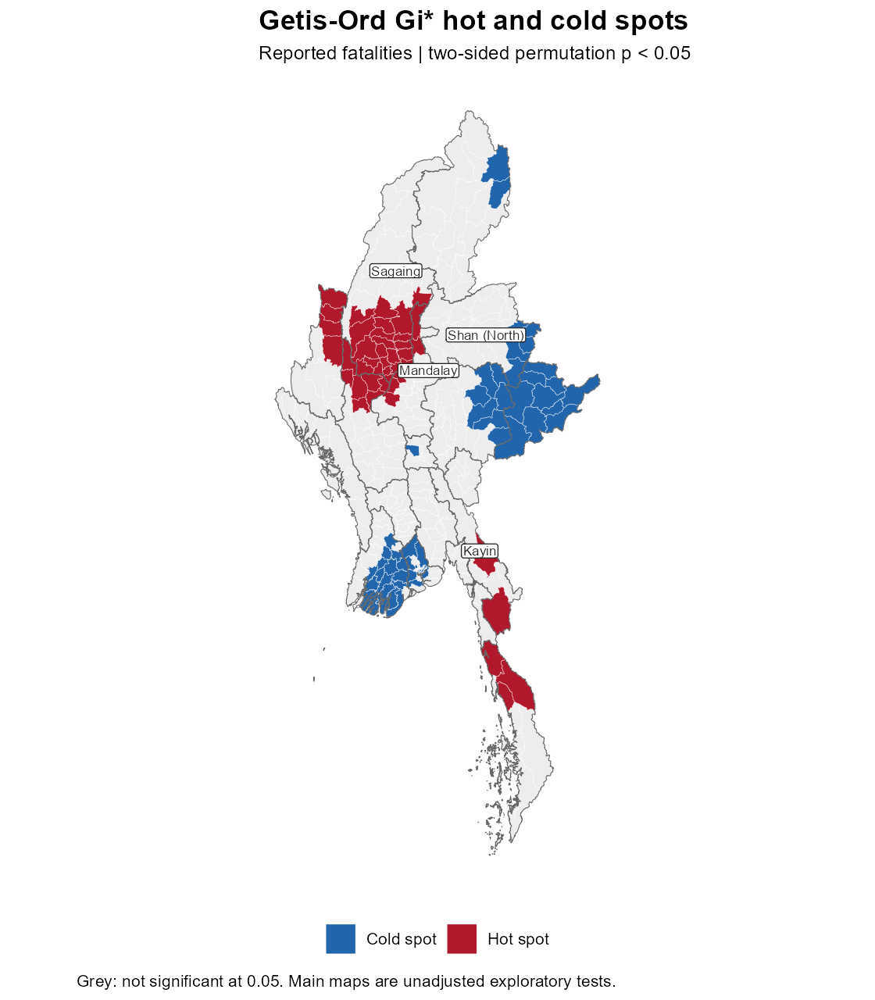{#fig-fatalities-gi}

```{r}
#| results: asis
#| echo: false
cat(sprintf('The fatality Gi* test yields %s hot-spot and %s cold-spot townships. %s townships are nominal hot spots under both outcomes. Agreement supports reviewing those areas across both frequency and recorded severity, but neither measure provides a population-adjusted estimate or an independently verified death toll.',sum(zf$hotspot=='Hot spot'),sum(zf$hotspot=='Cold spot'),sum(z$hotspot=='Hot spot' & zf$hotspot=='Hot spot')))
fatality_regions<-tibble(region=g$ST[match(zf$code[zf$hotspot=='Hot spot'],g$TS_PCODE)]) %>% count(region,sort=TRUE)
cat(sprintf(' %s contains the largest number: %s nominal fatality hot spots.',fatality_regions$region[1],fatality_regions$n[1]))
```

# Emerging hot spot analysis

## Space-time neighbourhood and classification

For each township-month, the Gi* neighbourhood contains the focal township and its spatial neighbours in the current month and the preceding month. January 2021 has no earlier bin and uses its current-month neighbourhood only. This is a retrospective, one-lag specification, not a forecasting model. Row standardisation accounts for differing neighbourhood sizes. The reference is the complete study cube, so national temporal change can contribute to local trends.

Space-time Gi* uses 999 conditional permutations with the focal observation fixed. A compiled Rcpp helper samples distinct non-focal bins by rejection sampling, avoiding full-population shuffles for every sparse neighbourhood. The two-sided p-value is twice the smaller inclusive-tail count, with a plus-one correction, capped at one. This handles ties conservatively. The helper was checked against exhaustive enumeration on a small graph; its Gi* z-values are computed by `spdep::localG`. Significant positive and negative bins define hot and cold episodes. A Mann-Kendall test of each township's 57 Gi* z-values measures monotonic change in clustering strength. Its tau is an ordinal association, not an events-per-month growth rate.

Sign-specific rules distinguish new, consecutive, intensifying, diminishing, persistent, historical, sporadic and oscillating patterns. For persistent/intensifying/diminishing patterns, at least 90% of bins must be significant in the same direction. The classification uses the versioned [ArcGIS Pro 3.4 pattern definitions](https://pro.arcgis.com/en/pro-app/3.4/tool-reference/space-time-pattern-mining/learnmoreemerging.htm), implemented explicitly in R. In particular, **a sporadic hot or cold spot must be significant in the same direction in September 2025**, have an earlier same-sign episode, fewer than 90% same-sign bins, and no opposite-sign episode. Earlier intermittent episodes with a non-significant final bin do not qualify. This definition differs from older documentation that omitted the terminal requirement.

The R workflow follows these pattern definitions but uses its own permutation-based inference. It does not reproduce ArcGIS numerically. The primary maps use nominal bin p-values to make the exercise's p < 0.05 threshold explicit. A separate sensitivity analysis classifies BH-adjusted bins, because the documented ArcGIS workflow uses multiple-testing correction. The two inference conventions must not be conflated.

The map additionally requires **Mann-Kendall p < 0.05** and a recognised pattern. A persistent hotspot without a significant trend can therefore be present in the full results but grey on this significance-filtered map. That is an intentional distinction between persistent clustering and evidence of change.

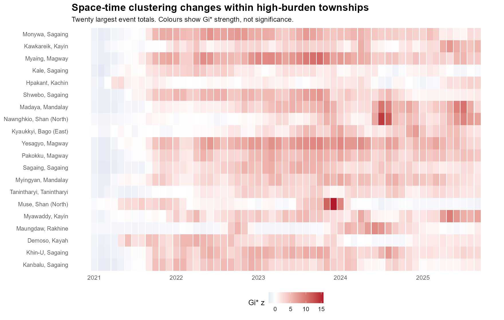{#fig-heatmap}

The heatmap contrasts clustering strength through time for the twenty highest-count townships. Its colours show z-values rather than a significance mask. It helps distinguish sustained concentrations from brief episodes before looking at the final classifications. Selection by total burden means this view is illustrative rather than representative of all townships.

## Event-count patterns

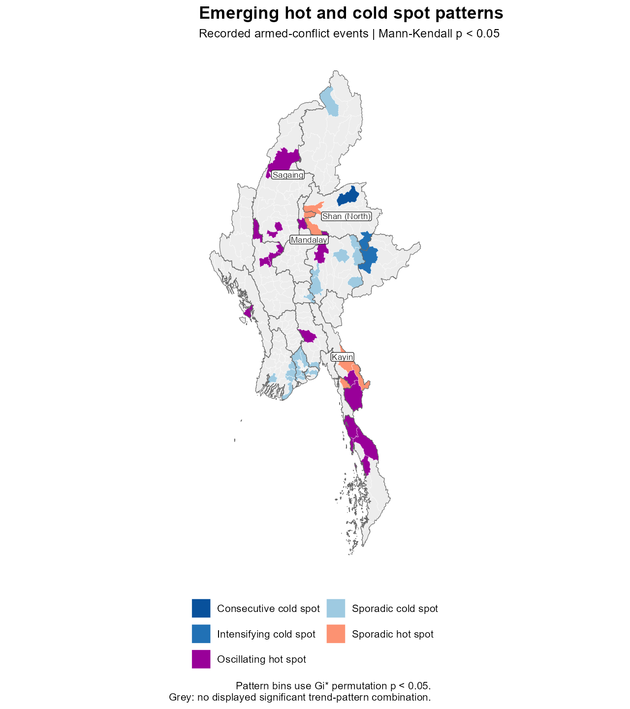{#fig-events-ehsa}

```{r}
#| results: asis
#| echo: false
ee<-s$ehsa %>% filter(variable=='events')
cat(sprintf('%s townships meet the unadjusted Mann-Kendall threshold; %s also have a recognised EHSA pattern and appear in colour. Positive tau indicates increasing Gi* values, which can mean intensifying high-value clustering or weakening low-value clustering. Negative tau has the reverse interpretation. The class label and the sign of Gi* must therefore be read together.',sum(ee$mk_p<.05),sum(ee$map_class!='Not displayed')))
```

## Fatality patterns

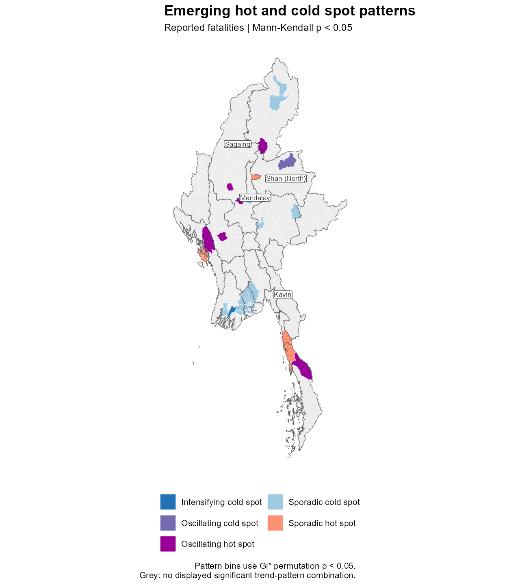{#fig-fatalities-ehsa}

```{r}
#| results: asis
#| echo: false
ef<-s$ehsa %>% filter(variable=='fatalities')
cat(sprintf('%s townships meet the Mann-Kendall threshold for reported fatalities, of which %s also have a recognised pattern. This map assesses changes in the spatial concentration of recorded fatalities. It does not estimate changes in casualty risk, and sharp episodes can influence the Gi* trajectory even when the broader pattern is not monotonic.',sum(ef$mk_p<.05),sum(ef$map_class!='Not displayed')))
```

## Pattern-by-pattern findings

Each row below is a short description of a displayed pattern, including its geographic examples. Counts refer to townships, not conflict events. Full classifications and test statistics are available in `outputs/ehsa_statistics.csv`.

```{r}
#| results: asis
#| echo: false
pattern_table<-s$ehsa %>% filter(map_class!='Not displayed') %>% group_by(variable,map_class) %>% summarise(townships=n(),examples=places(code,3),.groups='drop')
kable(pattern_table,col.names=c('Outcome','Pattern','Townships','Examples'))
```

New patterns appear only in the final significant bin. Consecutive patterns form a single terminal run of at least two months, with no earlier significant bin of the same sign. Intensifying and diminishing patterns show significant directional change within a long-standing hot/cold concentration. Historical patterns lose their significant terminal status after a high share of earlier significant bins. Oscillating patterns include an earlier opposite-sign episode and a significant final bin. Sporadic patterns recur intermittently, end in a significant same-sign bin and contain no opposite-sign episode. The explicit precedence is new, long-standing, consecutive, oscillating and sporadic. These rules summarise observed sequences rather than predict future conflict. Automated tests cover both signs, the 90% boundary and non-significant final months.

```{r}
#| results: asis
#| echo: false
pattern_explanation<-c(
 'Sporadic hot spot'='High-value episodes recur intermittently and the final month is hot. This supports a terminal concentration, but not sustained intensification throughout the study.',
 'Oscillating hot spot'='The terminal hot episode follows an earlier cold episode. This changing sign argues against describing the entire period as uniformly high-conflict.',
 'Sporadic cold spot'='Low-value clustering recurs intermittently and the final month is cold relative to the pooled reference. This is neither proof of safety nor necessarily a decline in absolute events.',
 'Intensifying cold spot'='At least 90% of months are cold and the Gi* trend becomes more negative. This is strengthening low-value clustering, not intensifying violence.',
 'Consecutive cold spot'='A previously absent same-sign pattern forms an uninterrupted cold run at the end of the study. Its persistence beyond September 2025 is unknown.',
 'Oscillating cold spot'='The terminal cold episode follows earlier hot clustering. This indicates a change in relative concentration, not demonstrated conflict resolution.')
for(j in seq_len(nrow(pattern_table))){
 row<-pattern_table[j,]
 part<-s$ehsa %>% filter(variable==row$variable,map_class==row$map_class)
 regions<-sort(table(g$ST[match(part$code,g$TS_PCODE)]),decreasing=TRUE)
 region_text<-paste(paste0(names(head(regions,2)),' (',as.integer(head(regions,2)),')'),collapse=' and ')
 cat(sprintf('\n\n### %s: %s\n\n',if(row$variable=='events')'Event counts' else 'Reported fatalities',row$map_class))
 cat(sprintf('This pattern covers %s townships; the largest regional counts are %s. %s Of these townships, %s also pass the three-month-block trend check and %s survive BH adjustment of the Mann-Kendall tests. The pattern is descriptive and its nominal trend significance should not override these uncertainty checks.\n\n',nrow(part),region_text,pattern_explanation[[row$map_class]],sum(part$block_p<.05),sum(part$mk_q<.05)))
}
```

# Robustness and uncertainty

## Multiple testing

```{r}
kable(s$inference,col.names=c('Outcome','Moran p < .05','Moran BH q < .05','Gi* p < .05','Gi* BH q < .05'))
kable(s$ehsa_summary,col.names=c('Outcome','MK p < .05','MK BH q < .05','Also supported by block test','Displayed EHSA patterns'))
```

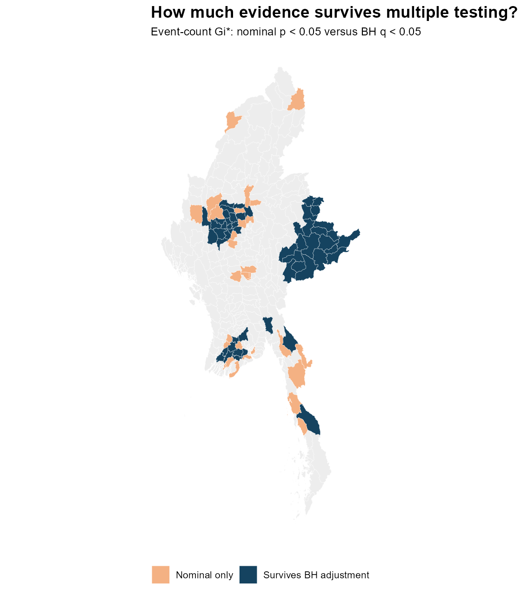{#fig-multiplicity}

The darker areas retain statistical support after adjusting the static event-count Gi* family. Nominal-only areas deserve more cautious interpretation. BH adjustment is a useful sensitivity check, not a correction for geolocation errors, uneven reporting or a misspecified neighbourhood. The unadjusted task maps should not be described as confirmed findings merely because they satisfy p < 0.05.

## Neighbourhood, geolocation and temporal dependence

```{r}
kable(s$sensitivity_summary,digits=3,col.names=c('Alternative','Moran class agreement','Gi* class agreement','Hot spots'))
```

Agreement compares all township labels, including non-significant ones, so it can be high even when some hotspots change. The six-nearest-neighbour graph tests the spatial definition; the precision-code-1 subset changes both location quality and sample composition; the one-kilometre reassignment tests the eight near-boundary exclusions. None is automatically a superior truth.

Neighbourhoods overlap in time and Gi* series can be serially correlated. The conventional Mann-Kendall p-value assumes temporal independence. The extended checks use **999 permutations each of consecutive 3-, 6- and 12-month blocks**, preserving order within each block and comparing absolute tau. A shorter final block is retained when the width does not divide 57. The plus-one p-value has resolution 0.001. These checks assume blocks are exchangeable under the null. They do not fully correct seasonality, non-stationarity or long-range dependence. In particular, the 12-month version has only five blocks and limited distinct rearrangements.

### Temporal evidence after sensitivity checks

```{r}
kable(e$temporal_summary,col.names=c('Outcome','MK p < .05','3-month support','6-month support','12-month support','BH + all blocks','Displayed patterns','Supported displayed'))
```

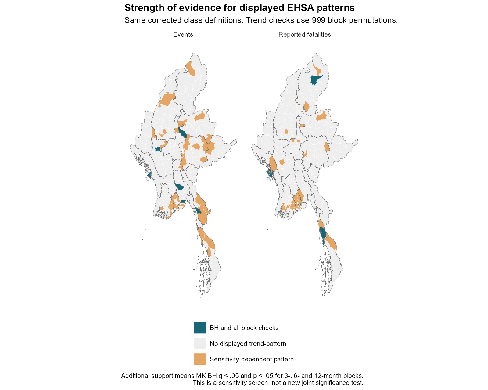{#fig-trend-robustness}

```{r}
#| results: asis
#| echo: false
for(v in c('events','fatalities')) {
 a<-e$temporal_summary %>% filter(variable==v)
 cat(sprintf('For %s, %s of %s displayed patterns also meet MK BH q < 0.05 and all three block thresholds. ',if(v=='events')'event counts' else 'reported fatalities',a$supported_displayed,a$displayed))
}
cat('Teal identifies this additional support; orange identifies dependence on the trend-testing assumptions. This intersection is a conservative sensitivity screen, not a calibrated joint p-value or proof of persistence. Grey combines unrecognised patterns and non-significant trends, rather than certifying an absence of conflict.')
```

### Temporal neighbourhood and bin adjustment

The baseline includes the current and previous month. Alternative models use the current month only, or the current plus two preceding months. Each repeats the Gi* simulation and pattern classification using the same spatial graph and seed. A fourth comparison retains the baseline z-values but replaces bin p-values with BH q-values across all 18,810 bins, separately for each outcome. It does not adjust the MK family a second time.

```{r}
kable(e$scenario_summary,digits=3,col.names=c('Outcome','Alternative','Full-class agreement','Displayed patterns','Same displayed pattern retained','Baseline displayed'))
```

Full-class agreement includes unclassified townships and can overstate stability. The retained-pattern column instead asks whether each baseline displayed township keeps exactly the same label. A changed label can reflect altered significance or a changed sequence of episodes. No scenario is selected because it produces more significant results. Complete township transitions are exported to `outputs/ehsa_sensitivity.csv`.

The sensitivity is material: after adjusting the baseline space-time bins, **`r sum(e$comparison$scenario=='BH-adjusted space-time bins' & e$comparison$variable=='events' & e$comparison$map_class!='Not displayed')` event** and **`r sum(e$comparison$scenario=='BH-adjusted space-time bins' & e$comparison$variable=='fatalities' & e$comparison$map_class!='Not displayed')` fatality** trend-pattern combinations remain displayed. This does not imply that recorded fatalities are absent or spatially random. It means the terminal-bin and sequence rules no longer produce displayed fatality classifications under that more stringent inference convention. The nominal EHSA maps should therefore be treated as exploratory, especially for fatalities.

### Stability of the actual hotspot sets

```{r}
kable(e$spatial_summary,digits=3,col.names=c('Outcome','Alternative','Baseline hot','Alternative hot','Retained','Gained','Lost','Jaccard'))
```

Jaccard similarity is the number of shared hot townships divided by the number hot in either analysis. Unlike overall label agreement, it excludes agreements between two non-hot labels. Both outcomes now receive the six-neighbour, precision-code-1 and boundary checks. Removing imprecisely located events also changes coverage and sample size, so it is a sensitivity analysis rather than an automatic improvement in truth.

# Frequency, severity and additional spatial evidence

## Do the two hotspot measures identify the same places?

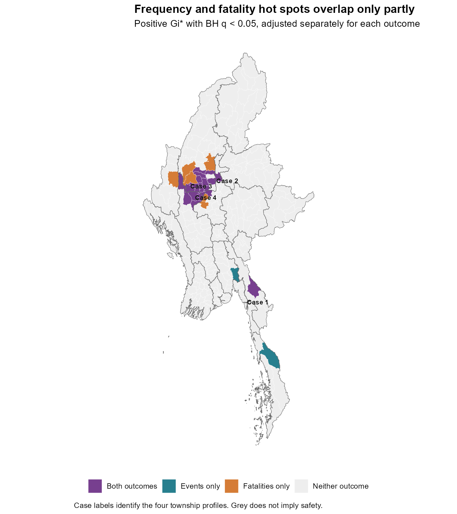{#fig-concordance}

```{r}
#| results: asis
#| echo: false
joint<-e$concordance_summary
get_n<-function(label)sum(joint$townships[joint$category==label])
cat(sprintf('%s townships are positive Gi* concentrations under both outcomes after separate BH adjustments; %s qualify only for events and %s only for fatalities. The distinction shows why event frequency alone can miss areas with relatively concentrated fatality burden. A difference between significance labels is not itself a statistically significant difference between the outcomes. Both tests reuse the same incident records, and the comparison remains descriptive. The four numbered locations are examined below.',get_n('Both outcomes'),get_n('Events only'),get_n('Fatalities only')))
```

```{r}
kable(e$joint_stability,col.names=c('Alternative','Hot under both outcomes','Original joint hot spots retained'))
```

## Conditional spatial random-labelling of fatality severity

**Additional question:** Which local neighbourhoods have more reported fatalities than expected from their recorded event locations, months and event-type composition?

This extends the core count-based analyses through a conditional simulation. Each event keeps its township, month and type. Within each month-by-event-type stratum, fatality marks are randomly reassigned among the recorded events without replacement. The procedure preserves incident frequency, temporal patterns, type composition and each stratum's entire fatality distribution. It breaks the association between location and severity within those strata.

The reference model adapts the grouped random-labelling principle documented in [spatstat's `rlabel`](https://spatstat.r-universe.dev/spatstat.random/doc/manual.html#rlabel): locations stay fixed while marks are permuted within groups. Here, explicit R code computes an areal-neighbourhood statistic rather than a point-pattern summary function.

The statistic for each township is the fatality sum in its **self-including queen neighbourhood**. Its conditional expectation sums the month/type mean fatality mark over the events in that neighbourhood. The observed-to-expected ratio describes excess severity, not individual fatality risk. A one-sided upper-tail p-value uses 999 randomisations and a plus-one correction. BH adjusts the family of 330 township neighbourhoods. The complete analysis is repeated on precision-code-1 records, with expectations recalculated for that subset.

This is a random-labelling reference model, not a causal model. It assumes exchangeable fatality marks within each month/type stratum under the null. Reporting differences, actor composition and correlated incidents can violate that assumption. Overlapping neighbourhoods are dependent; the BH screen is exploratory and does not establish arbitrary-dependence control. The same underlying incidents can contribute to several neighbourhoods, so their totals must never be added together. The approach complements raw fatality hotspots by conditioning on recorded frequency and type.

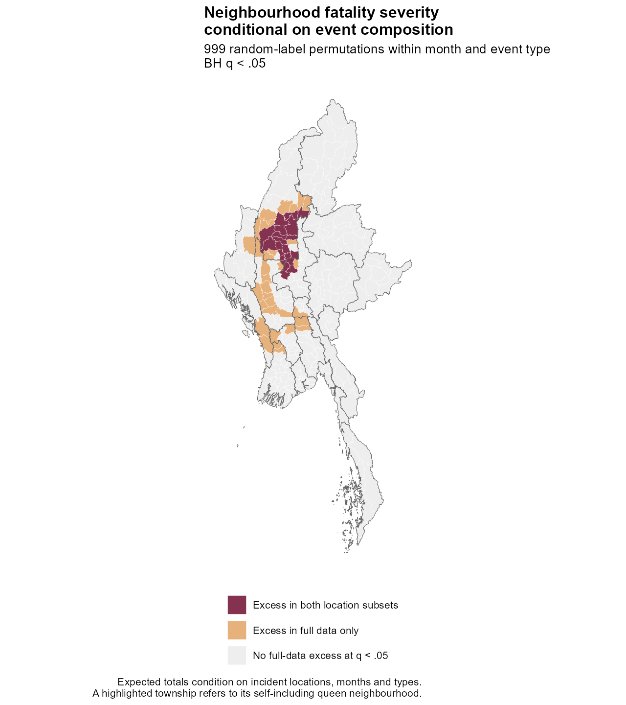{#fig-severity}

```{r}
#| results: asis
#| echo: false
sev<-e$severity
top_sev<-sev %>% filter(excess) %>% arrange(desc(ratio),code) %>% slice_head(n=3)
cat(sprintf('%s neighbourhoods have excess fatality marks at BH q < 0.05; %s also pass the independently rerun precision-code-1 analysis. Among full-data excess neighbourhoods, %s are outside the ordinary fatality Gi* hotspot set after BH adjustment. These findings answer a conditional severity question that the raw-count maps do not. Examples with the largest observed-to-expected ratios include %s. Each name identifies the focal township plus its neighbours. The result supports checking local incident composition and reporting before interpreting fatalities simply as a consequence of frequent events.',sum(sev$excess),sum(sev$excess & sev$precise_excess),sum(sev$excess & !(sev$category %in% c('Both outcomes','Fatalities only'))),paste(paste0(top_sev$township,' (',top_sev$region,')'),collapse='; ')))
cat(sprintf(' Of these three examples, %s retain q < 0.05 in the precise-only analysis, so the large ratios alone should not determine which places receive strongest emphasis.',sum(top_sev$precise_q<.05)))
```

```{r}
kable(top_sev %>% select(township,region,neighbourhood_events,observed,expected,ratio,p,q,precise_q),digits=3,
 col.names=c('Focal township','Region','Neighbourhood events','Observed fatalities','Expected','O/E','p','BH q','Precise-only q'))
```

## Stable severity cases and their substantive contribution

The three examples below come from the **21** neighbourhoods with excess severity in both the full and precision-code-1 analyses. Selection ranks the smaller of their two O/E ratios and accepts a case only when its township-neighbourhood Jaccard overlap with every previously selected case is at most 0.5. P-code breaks ties. This limits near-duplicate examples without claiming independent validation. All three selected focal townships are in Sagaing and fall outside the separately BH-adjusted ordinary event and fatality Gi* hotspot sets.

```{r}
kable(h$robust_cases %>% select(case_label,township,region,neighbourhood_events,observed,expected,ratio,q,precise_ratio,precise_q),digits=3,
 col.names=c('Case','Focal township','Region','Events','Observed fatalities','Expected','O/E','BH q','Precise O/E','Precise q'))
```

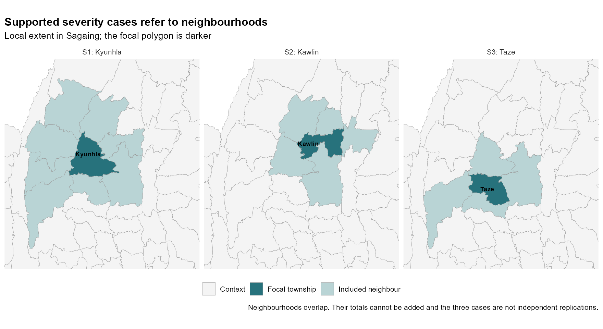{#fig-severity-neighbours}

Each panel highlights a focal township and every polygon included in its self-including queen neighbourhood. These are the areas to which the severity totals refer, rather than the focal polygon alone. Their pairwise neighbourhood Jaccard overlaps range from `r sprintf('%.3f',min(h$overlap$Jaccard))` to `r sprintf('%.3f',max(h$overlap$Jaccard))`. Shared townships make the examples correlated, so neither incident counts nor fatalities should be added across cases. This local map provides geographical context that the national significance map cannot show at the same level of detail.

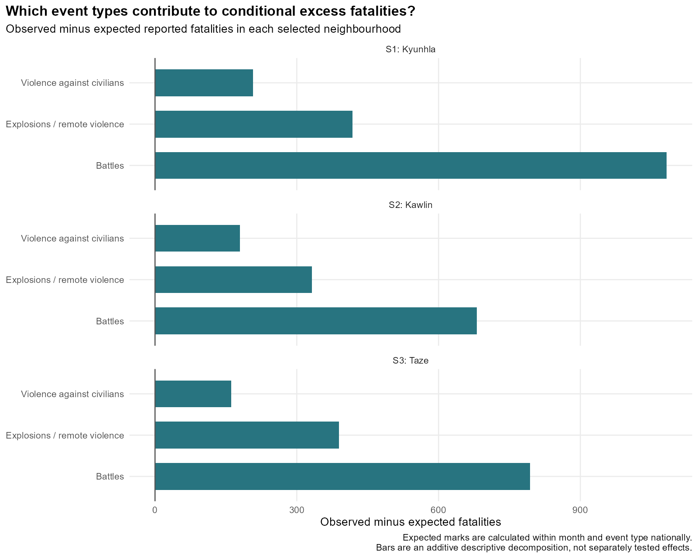{#fig-severity-types}

Battles contribute the largest observed-minus-expected fatality amount in each selected neighbourhood. This is more informative than saying that there are many battles: the expectation already preserves each neighbourhood's recorded mix of event types and months. The difference therefore concerns fatality marks within those strata. The bars are a descriptive decomposition of the tested total, not separately significant event-type effects. Positive and negative contributions can offset, so a type's share of net excess can exceed 100%. Reporting practices and correlated incidents remain alternative explanations.

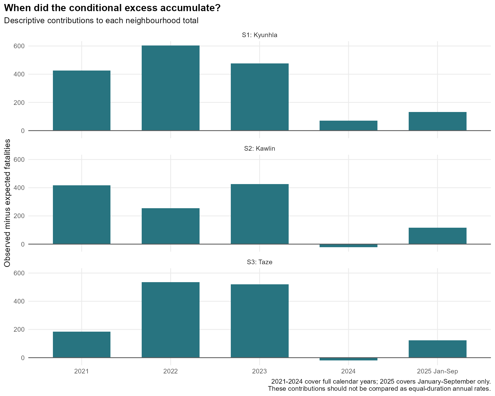{#fig-severity-periods}

The largest contributions occur in 2022 for Kyunhla and Taze, and in 2023 for Kawlin. This locates the periods to prioritise for contextual verification without claiming continuous escalation. The 2025 bar includes only January-September and cannot be read as a comparable full-year rate. A high past contribution is not evidence of current operational danger. No individual-incident details are displayed.

```{r}
#| results: asis
#| echo: false
for(j in seq_len(nrow(h$robust_cases))) {
 rc<-h$robust_cases[j,]
 driver<-h$drivers[h$drivers$code==rc$code,]
 peak<-h$peak_period[h$peak_period$code==rc$code,]
 cat(sprintf('\n\n### %s: %s neighbourhood\n\n',rc$case_label,rc$township))
 cat(sprintf('Across %s townships, %s retained incidents contain %s reported fatalities against a conditional expectation of %.1f. The O/E ratio is %.2f (BH q = %.3f), increasing to %.2f in the precision-code-1 analysis (q = %.3f). ',rc$neighbour_townships,fmt(rc$neighbourhood_events),fmt(rc$observed),rc$expected,rc$ratio,rc$q,rc$precise_ratio,rc$precise_q))
 cat(sprintf('%s contribute %.1f excess fatalities, or %.1f%% of the net excess; %s supplies the largest calendar-period contribution. The single largest incident represents %.1f%% of observed fatalities, while the largest month contributes %.1f%%. These concentration checks describe leverage but do not replace a leave-one-out test. ',driver$event_type,driver$excess,driver$net_excess_share_pct,peak$year,rc$largest_incident_pct,rc$largest_month_pct))
 cat('The focal township is not an ordinary BH-adjusted event or fatality hotspot. The added insight is therefore conditional severity beyond raw concentration. This supports checking incident composition and reporting in the neighbourhood, not a causal explanation or an assistance ranking.\n\n')
}
```

## Randomisation stability and largest-incident sensitivity

The three severity cases were fixed before these checks; no failed case is replaced. Each of three recorded seeds repeats the complete severity analysis with **1,999 permutations**, separately for all assigned records and precision-code-1 records. BH adjustment always covers all 330 neighbourhoods, not only the selected three. Observed counts and O/E ratios stay fixed within each sample; only Monte Carlo p-values vary. The resulting q-value ranges describe simulation sensitivity, not confidence intervals.

```{r}
kable(severity_validation$seed_cases %>%
 mutate(scenario=if_else(scenario=='All assigned events','Full','Precise'),
        across(c(p_min,p_max,q_min,q_max),~sprintf('%.4f',.x))) %>%
 select(township,scenario,ratio,supported_runs,runs,p_min,p_max,q_min,q_max),
 digits=2,col.names=c('Township','Sample','O/E','Supported','Runs','Min p','Max p','Min q','Max q'))
kable(severity_validation$seed_families,col.names=c('Sample','Seed','Supported neighbourhoods'))
```

The total number of supported full-data neighbourhoods ranges from **`r min(severity_validation$seed_families$supported_neighbourhoods[severity_validation$seed_families$scenario=='All assigned events'])` to `r max(severity_validation$seed_families$supported_neighbourhoods[severity_validation$seed_families$scenario=='All assigned events'])`** across these runs. The baseline total of 53 is therefore a simulation-specific screen, not an exact count of genuinely elevated neighbourhoods. Stability of the three selected cases does not establish stability of the entire national set. The minimum attainable p-value is 0.0005; a result at this floor indicates simulation resolution, not a zero probability or an exact tail probability.

The second check removes the single largest-fatality record **within each selected neighbourhood**, with event ID breaking tied maxima deterministically. It repeats the entire 330-neighbourhood test and recalculates stratum means, expected fatalities and BH values. This creates a separate counterfactual dataset for each focal case and sample. It does not remove the three maxima simultaneously, and a maximum in the precise-only sample may differ from the full-data maximum. The fixed seed is 20265001 and each test uses 1,999 permutations. Event IDs remain private. In the case tables, Full means all assigned records and Precise means precision code 1.

```{r}
kable(severity_validation$deletion_cases %>%
 mutate(scenario=if_else(scenario=='All assigned events','Full','Precise'),
        expected=round(expected,1),across(c(p,q),~sprintf('%.4f',.x)),
        supported=if_else(supported,'Yes','No')) %>%
 select(township,scenario,removed_fatalities,observed,expected,ratio,p,q,supported),
 digits=2,col.names=c('Township','Sample','Deaths removed','Observed','Expected','O/E','p','BH q','Supported'))
```

```{r}
#| results: asis
#| echo: false
cat(sprintf('Across the three cases and two samples, %s of %s case/sample combinations retain excess-severity support in all three seed runs. After the largest-record deletion, %s of %s combinations retain BH q < 0.05 and O/E > 1. ',
 sum(severity_validation$seed_cases$supported_runs==severity_validation$seed_cases$runs),nrow(severity_validation$seed_cases),
 sum(severity_validation$deletion_cases$supported),nrow(severity_validation$deletion_cases)))
failed<-severity_validation$deletion_cases %>% filter(!supported)
if(nrow(failed))cat('Deletion-sensitive combinations are ',paste(paste0(failed$township,' (',failed$scenario,')'),collapse='; '),'. ',sep='')
cat('These checks address randomisation variation and dependence on one exceptionally severe record. They do not establish independence of the cases, validate fatality reporting, or test deletion of a whole campaign or month. Case selection remains descriptive, and the unchanged 999-permutation main EHSA is not validated by these severity-specific checks.')
```

# Township case studies

Cases are selected by fixed contrast rules: the largest event total among displayed oscillating event hot spots, the largest among displayed sporadic event hot spots, the largest without a displayed event trend-pattern, and the largest fatality total among fatality-only BH hot spots. Already selected townships are excluded from subsequent slots, with P-code breaking ties. These illustrative cases are selected from the analysed data, not an independent validation sample or a claim to represent all Myanmar townships.

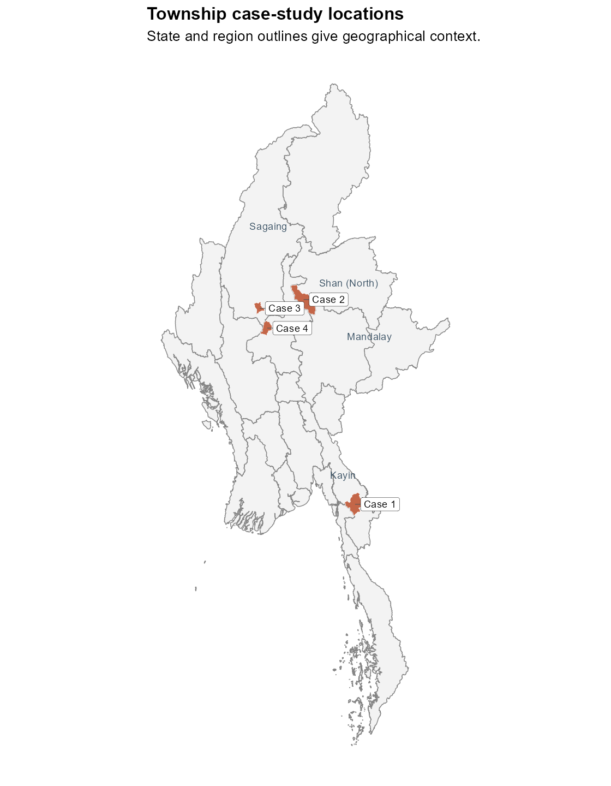{#fig-case-locator}

```{r}
kable(e$cases %>% select(case_id,township,region,selection_reason),col.names=c('Case','Township','State/region','Selection rule'))
```

Each profile separates monthly counts from space-time Gi* values. The median of all pairwise monthly slopes (Sen's slope) quantifies Gi* change in **z-units per month** and count change in **events or reported fatalities per month**. These are descriptive slopes without independence-based confidence intervals. A linear summary can conceal episodes and structural breaks; its sign does not replace the EHSA sequence. January–September 2024 and 2025 totals compare identical calendar windows, avoiding a partial-year versus full-year comparison.

```{r}
#| results: asis
#| echo: false
for(j in seq_len(nrow(e$cases))) {
 cse<-e$cases[j,]
 a<-e$case_stats %>% filter(code==cse$code)
 evc<-a %>% filter(variable=='events');fac<-a %>% filter(variable=='fatalities')
 cat(sprintf('\n\n## %s: %s, %s\n\n',cse$case_id,cse$township,cse$region))
 cat(sprintf('{#fig-case-%s}\n\n',cse$township,j,j))
 peak<-e$case_trends %>% filter(township_id==cse$code,variable=='events') %>% arrange(desc(value),month) %>% slice_head(n=1)
 cat(sprintf('Across 57 months, this township records %s events and %s reported fatalities. Its largest monthly event count is %s in %s (the earliest month if tied). The corrected event pattern is **%s**; the fatality pattern is **%s**. ',fmt(cse$events),fmt(cse$fatalities),fmt(peak$value),format_month_en(peak$month),evc$classification,fac$classification))
 cat(sprintf('The event trend %s the MK BH and all-block screen. Between January-September 2024 and the same months of 2025, events change from %s to %s and fatalities from %s to %s. ',if(evc$trend_supported)'passes' else 'does not pass',fmt(evc$Jan_Sep_2024),fmt(evc$Jan_Sep_2025),fmt(fac$Jan_Sep_2024),fmt(fac$Jan_Sep_2025)))
 meaning<-switch(as.character(j),
  '1'='An earlier cold episode and a terminal hot episode explain the oscillating label. Event counts increase more strongly than fatalities in the matched window, but the 12-month-block test does not support the event trend at 0.05.',
  '2'='The final hot episode follows intermittent earlier hot months without cold episodes. Events increase in the matched window while fatalities decrease, illustrating that rising recorded frequency need not mean rising fatality burden.',
  '3'='The matched-window decline coexists with a large cumulative burden. Its grey event EHSA polygon cannot be read as low humanitarian need. The raw fatality sequence has a recognised pattern, but its MK trend fails the display threshold.',
  '4'='The fatality-only adjusted hotspot is missed by an event-frequency hotspot screen. Both matched-window totals decline despite positive full-period Gi* slopes, showing that a long-period trend is not a recent-growth estimate.')
 cat(meaning,' Regional explanations require independent historical and reporting evidence; the statistical profile alone does not identify causes.\n\n')
 print(kable(a %>% select(variable,tau,mk_p,mk_q,block_3,block_6,block_12,gi_slope,count_slope) %>%
  mutate(across(c(mk_p,mk_q,block_3,block_6,block_12),fmt_p)),digits=3,
  col.names=c('Outcome','tau','MK p','MK q','Block 3 p','Block 6 p','Block 12 p','Gi* z/month','Count/month')))
 cat('\n\n')
}
```

# Local change in the national context

## A constant-share comparison

Raw-count EHSA uses a pooled space-time reference and can respond to nationwide change. The following diagnostic asks whether the four township profiles also gain or lose **share of the recorded national total**. For township i and period t, the share is its retained count divided by the sum across all 330 townships. The benchmark for January-September 2025 holds the township's January-September 2024 share constant and multiplies it by the 2025 national total. Relative growth is `(local 2025 / local 2024) / (national 2025 / national 2024)`; values above one indicate a share gain. A zero starting local total leaves that ratio undefined rather than introducing a pseudocount.

This is an accounting benchmark, not a fitted causal model, population-adjusted risk estimate or replacement EHSA. Shares are compositional and use the same potentially incomplete reporting system. Comparing the same nine months reduces unequal-duration and calendar-season differences, but cannot remove changes in reporting coverage. Quarterly shares below use all three months' totals, not an average of monthly percentages.

```{r}
kable(h$national_windows,digits=1,col.names=c('Outcome','Jan-Sep 2024','Jan-Sep 2025','National change %'))
kable(h$case_comparison %>% select(township,variable,local_2024,local_2025,share_2024,share_2025,expected_2025,relative_growth),digits=2,
 col.names=c('Township','Outcome','2024 count','2025 count','2024 share %','2025 share %','Constant-share benchmark','Relative growth'))
```

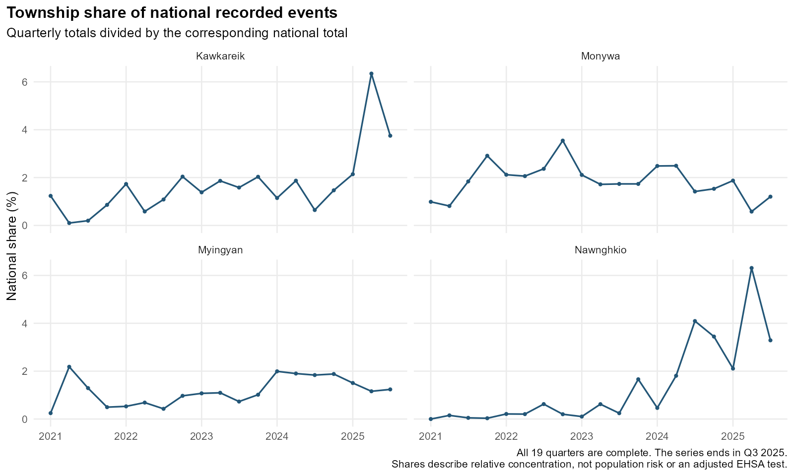{#fig-national-events}

National retained events fall from 9,975 to 8,749 between January-September 2024 and 2025 (12.3%). In contrast, Kawkareik's events increase from 122 to 356 and its share rises from 1.22% to 4.07%; Nawnghkio increases from 202 to 341, with its share rising from 2.03% to 3.90%. Their matched-window increases therefore cannot be explained by an increasing national event total in that window. Monywa and Myingyan lose event share as well as counts. These comparisons strengthen the geographical interpretation while leaving the original full-period EHSA tests unchanged.

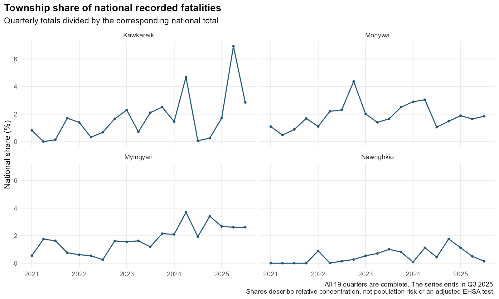{#fig-national-fatalities}

National reported fatalities decline by 29.5% in the matched windows. Kawkareik increases in both count and share. Nawnghkio's count falls from 91 to 70, yet its national share rises slightly from 0.54% to 0.59%; Myingyan similarly falls from 428 to 313 while its share moves from 2.54% to 2.63%. Neither small share increase establishes a statistically significant increase. Monywa declines in both measures. Absolute decline and relative concentration can coexist, so a falling fatality count alone does not establish improvement relative to the national pattern.

The strongest supported statement is window-specific: Kawkareik and Nawnghkio gain event share during a national decline, while Monywa and Myingyan lose event share. This diagnostic does **not** show that national trends have been removed from all 57-month Gi* trajectories. Causal explanations and independent reporting validation remain outside the available evidence.

## Contemporaneous humanitarian context

**Nawnghkio, northern Shan.** OCHA's [28 March 2025 update, “Continued insecurity in the Northeast”](https://myanmar.un.org/en/291781-myanmar-humanitarian-update-no-45) describes repeated clashes and aerial attacks in Nawnghkio, including reported civilian casualties. This supplies contemporaneous context for examining its growing event share. It does not independently verify this report's exact incident counts or explain why fatalities decline in the matched window. Humanitarian reporting and ACLED may also draw on overlapping underlying sources.

**Kawkareik within Kayin.** The same [OCHA update, southeastern Myanmar discussion](https://myanmar.un.org/en/291781-myanmar-humanitarian-update-no-45) reports approximately 2,800 people displaced in Kayin since mid-February 2025, alongside conflict-related needs for food, medicine and relief items. This evidence is at state level, not an estimate for Kawkareik. It supports examining displacement and service access alongside the township's increased recorded activity, but cannot allocate those displaced people to this case or establish a township-level causal explanation.

**Implication for both cases.** OCHA's [23 September 2025 update](https://myanmar.un.org/en/302070-myanmar-humanitarian-update-no-49) identifies continued displacement and severe humanitarian-access constraints, particularly in the Northwest and Southeast. Accordingly, neither a national decline in recorded counts nor a local cold-spot label establishes falling humanitarian need. These sources fall within the study period. They are contextual evidence, not extra observations inserted into the statistical tests, and do not validate the selected Sagaing severity neighbourhoods' 2022–2023 peaks.

# Integrated interpretation and peace-building implications

The analysis separates where burden accumulated from whether local concentrations changed. Areas supported by both outcome measures, multiple-testing adjustment and sensitivity checks are stronger candidates for contextual review than areas identified by one nominal test alone. Event counts capture frequency, while reported fatalities add a severity perspective.

Sagaing contains the largest number of nominal static hot spots for both outcomes: **`r event_regions$n[1]` event-count hot spots** and **`r fatality_regions$n[1]` fatality hot spots**. The monthly peak for both measures is November 2023. However, the time-pattern maps are dominated by intermittent classes rather than intensifying hot spots. There are **`r sum(ee$map_class=='Sporadic hot spot')` sporadic and `r sum(ee$map_class=='Oscillating hot spot')` oscillating event hot spots**, compared with **`r sum(ef$map_class=='Sporadic hot spot')` and `r sum(ef$map_class=='Oscillating hot spot')`** for fatalities. Accumulated burden and persistent escalation are therefore not interchangeable findings.

Humanitarian interpretation should combine these results with independent information about displacement, access, health services and local reporting. Low observed activity must not justify withdrawing support from under-observed areas. Township aggregation is suitable for strategic discussion, but obscures variation within large townships and does not identify safe routes, individual exposure, perpetrators or causal mechanisms. No operational targeting recommendations follow from these maps.

| Case evidence | Implication for humanitarian assessment | Information still needed |
|---|---|---|
| Kawkareik: recent recorded activity increases, but the long-block event trend check fails | Review recent needs without describing the entire period as a stable escalation | Reporting continuity, displacement and service availability during the matched windows |
| Nawnghkio: event counts increase while reported fatalities decrease in the matched windows | Keep frequency and severity indicators separate when reviewing changing needs | Incident composition, fatality reporting quality and independent local assessments |
| Monywa: large cumulative burden, declining matched-window counts and no displayed event pattern | Retain accumulated harm in the assessment even when the temporal map is grey | Unmet needs, recovery conditions and changes in observation coverage |
| Myingyan: fatality-only adjusted hotspot, with a recent decline despite a positive full-period Gi* slope | Include recorded severity in contextual screening and avoid presenting a long-period slope as current growth | Severe-incident details at an appropriate aggregate level and corroborating humanitarian evidence |

Kyunhla, Kawlin and Taze add a complementary severity finding outside the ordinary adjusted count hotspots. Their decompositions point to battles and past concentrations, rather than uninterrupted recent escalation. These screens identify questions for local assessment; they do not prescribe resource allocation by statistical rank.

# Limitations and conclusion

ACLED records depend on source availability and coding decisions. Locations and dates have varying precision; fatalities are uncertain. The fixed boundary vintage may not match all administrative changes during 2021–2025. Count-based association confounds population, area, reporting intensity and underlying conflict activity. Results also depend on temporal aggregation, weight definitions, multiplicity handling and the pooled space-time reference.

Three conclusions follow:

- **Overall association:** positive Global Moran association survives all `r sum(global_moran$sensitivity$positive_supported)` tested scale/weight settings after eight-test Holm adjustment. Existing local tests identify where concentrations and contrasts occur.
- **Temporal change:** only **`r sum(e$checks$variable=='events' & e$checks$map_class!='Not displayed' & e$checks$trend_supported)` of `r sum(ee$map_class!='Not displayed')` event** and **`r sum(e$checks$variable=='fatalities' & e$checks$map_class!='Not displayed' & e$checks$trend_supported)` of `r sum(ef$map_class!='Not displayed')` fatality** displayed patterns pass the additional trend screen. National temporal confounding remains unresolved.
- **Conditional severity:** the three selected neighbourhoods retain support across repeated seeds and largest-record deletion in both samples. Their overlapping neighbourhoods and data-driven selection preclude independent validation claims.

Together these findings support contextual investigation of burden, change and severity. They do not establish safe areas, causal diffusion or steadily intensifying conflict throughout Myanmar.

# Reproducibility

The report and executive summary read the same analytical outputs. Raw inputs remain unchanged. From the exercise folder, run `Rscript --vanilla analysis/run_analysis.R`, then render the two QMD documents. Dependencies are checked rather than installed automatically; changed inputs, analysis scripts or package versions invalidate the relevant caches.

The [technical appendix](#technical-appendix) contains the complete analysis scripts, test and rebuild instructions, input fingerprints and runtime information. It is collapsed by default. Individual event notes and coordinates are not embedded in the reporting pages.

AI assistance was used to optimise parts of the R code and fix some bugs.

# References

- [ISSS626 Take-home Exercise 2 brief](https://isss626-ay2026-27aug.netlify.app/take-home_ex02), accessed 18 October 2026.
- [ACLED Codebook](https://acleddata.com/methodology/acled-codebook). Event definitions, spatial/temporal precision and data limitations.
- [MIMU GeoNode](https://geonode.themimu.info/). Myanmar Township Boundaries, version 9.4 as recorded in the supplied layer.
- [spdep Local Moran's I](https://r-spatial.github.io/spdep/reference/localmoran.html) and [Gi/Gi* documentation](https://r-spatial.github.io/spdep/reference/localG.html).
- [Esri ArcGIS Pro 3.4: How Emerging Hot Spot Analysis works](https://pro.arcgis.com/en/pro-app/3.4/tool-reference/space-time-pattern-mining/learnmoreemerging.htm). Versioned conceptual pattern definitions, including the terminal-bin condition for sporadic patterns.
- [Kendall package](https://cran.r-project.org/package=Kendall). Mann-Kendall implementation.
- [spatstat.random manual: `rlabel`](https://spatstat.r-universe.dev/spatstat.random/doc/manual.html#rlabel). Grouped random labelling as a conditional reference model.
- [OCHA, Myanmar Humanitarian Update No. 45](https://myanmar.un.org/en/291781-myanmar-humanitarian-update-no-45), 28 March 2025. Township-level context for Nawnghkio and state-level displacement context for Kayin.
- [OCHA, Myanmar Humanitarian Update No. 49](https://myanmar.un.org/en/302070-myanmar-humanitarian-update-no-49), 23 September 2025. Displacement and humanitarian-access constraints.

# Technical appendix {.unnumbered}

<details id="technical-appendix-details" class="technical-appendix">
<summary>Expand full analysis code, verification and runtime environment</summary>

## Build entry point and reporting helper {.unnumbered .unlisted}

`analysis/run_analysis.R` checks dependencies and manages the analysis cache. `analysis/report_helpers.R` supplies English month names independently of the computer's locale; it changes presentation only.

```{r}
#| echo: false
#| results: asis
for (script in c('analysis/run_analysis.R', 'analysis/report_helpers.R')) {
  cat('\n\n### ', basename(script), ' {.unnumbered .unlisted}\n\n```r\n',
      paste(readLines(script), collapse='\n'), '\n```\n', sep='')
}
```
## Preparation code {.unnumbered .unlisted}

```{r}
#| echo: false
#| results: asis
cat('```r\n',paste(readLines('analysis/01_prepare.R'),collapse='\n'),'\n```')
```

## Statistical code {.unnumbered .unlisted}

```{r}
#| echo: false
#| results: asis
cat('```r\n',paste(readLines('analysis/02_statistics.R'),collapse='\n'),'\n```')
```

## Visualisation code {.unnumbered .unlisted}

```{r}
#| echo: false
#| results: asis
cat('```r\n',paste(readLines('analysis/03_figures.R'),collapse='\n'),'\n```')
```

## Supplementary global analysis code {.unnumbered .unlisted}

`analysis/09_global_moran.R` adds global permutation tests, the scatterplot and the eight-setting sensitivity table without changing the original local, EHSA or robustness outputs. Its cache tracks the upstream signatures and its own source. Checks cover township alignment, the direct Moran formula, scatterplot slope, both Holm families, graph symmetry and repeated permutations. The earlier clean-directory verification below predates this stage.

```{r}
#| echo: false
#| results: asis
cat('```r\n',paste(readLines('analysis/09_global_moran.R'),collapse='\n'),'\n```')
```

## Efficient conditional-simulation helper {.unnumbered .unlisted}

A fresh statistical rebuild requires Rcpp and an R-compatible C++ compiler, such as Rtools on Windows. The rejection sampler retains the conditional, without-replacement reference model; it does not lower the number of simulations. Cached rendering does not require recompiling it.

```{r}
#| echo: false
#| results: asis
cat('```r\n',paste(readLines('analysis/fast_gi.R'),collapse='\n'),'\n```')
```

## Extended analysis and verification {.unnumbered .unlisted}

`analysis/04_extensions.R` implements temporal sensitivity, hotspot-set comparisons, the conditional severity test and deterministic case selection. `analysis/05_extension_figures.R` generates the corresponding figures. `analysis/06_evidence_audit.R` diagnoses name flags, recomputes static sensitivity results, calculates national-share benchmarks and decomposes supported severity cases. `analysis/07_evidence_figures.R` draws these additional results. `analysis/08_severity_validation.R` repeats the preselected severity cases across seeds and largest-record deletion scenarios, retaining full-family adjustment. The stage cache includes these scripts so changed analytical choices invalidate dependent outputs. `analysis/test_analysis.R` checks pattern boundaries, raw-data fingerprints, count reconciliation, map masks, name-audit accounting, national-share identities, additive severity decompositions, deletion accounting and a small-graph exhaustive comparison for the Gi* sampler. These internal tests complement, rather than replace, independent methodological review.

From the exercise directory, `Rscript --vanilla analysis/test_analysis.R` runs the checks after a build. `Rscript --vanilla -e "Sys.setenv(TH02_REBUILD='1'); source('analysis/run_analysis.R')"` rebuilds all stages. Required package versions and external spatial-library versions are recorded below; they document the tested environment rather than claiming compatibility with every package version. On Windows, Rcpp also requires a working Rtools toolchain. For non-ASCII temporary-path issues, set `TMPDIR` to an existing writable ASCII-only directory before starting R.

A separate-directory verification copied only source files and raw inputs before starting the complete analysis without any existing outputs or stage cache. Preparation, core statistics, extensions, evidence audits, severity validation and figure-data objects matched the project outputs at a numerical tolerance of 1e-12. Raw-input fingerprints matched and the automated checks passed. Both runs used the same installed R environment, so this verifies independence from cached results rather than portability to another machine or independent validation of the source data. To repeat the check, copy the required sources, styles and locally authorised data to an empty directory, run `Rscript --vanilla analysis/run_analysis.R`, then run the tests and render the report.

```{r}
#| echo: false
#| results: asis
for(script in c('analysis/04_extensions.R','analysis/05_extension_figures.R','analysis/06_evidence_audit.R','analysis/07_evidence_figures.R','analysis/08_severity_validation.R','analysis/test_analysis.R')) {
 cat('\n\n### ',basename(script),' {.unnumbered .unlisted}\n\n```r\n',paste(readLines(script),collapse='\n'),'\n```\n',sep='')
}
```

## Session and input fingerprints {.unnumbered .unlisted}

```{r}
kable(data.frame(file=names(d$quality$hashes),md5=unname(d$quality$hashes)))
sessionInfo()
sf::sf_extSoftVersion()
```

</details>
