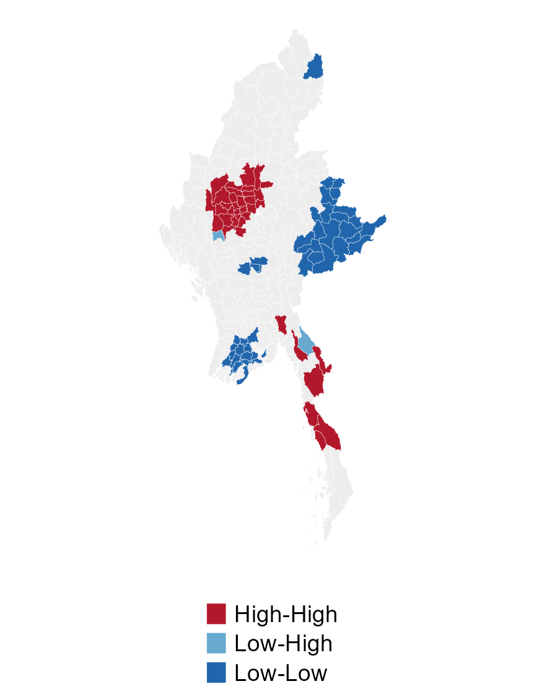
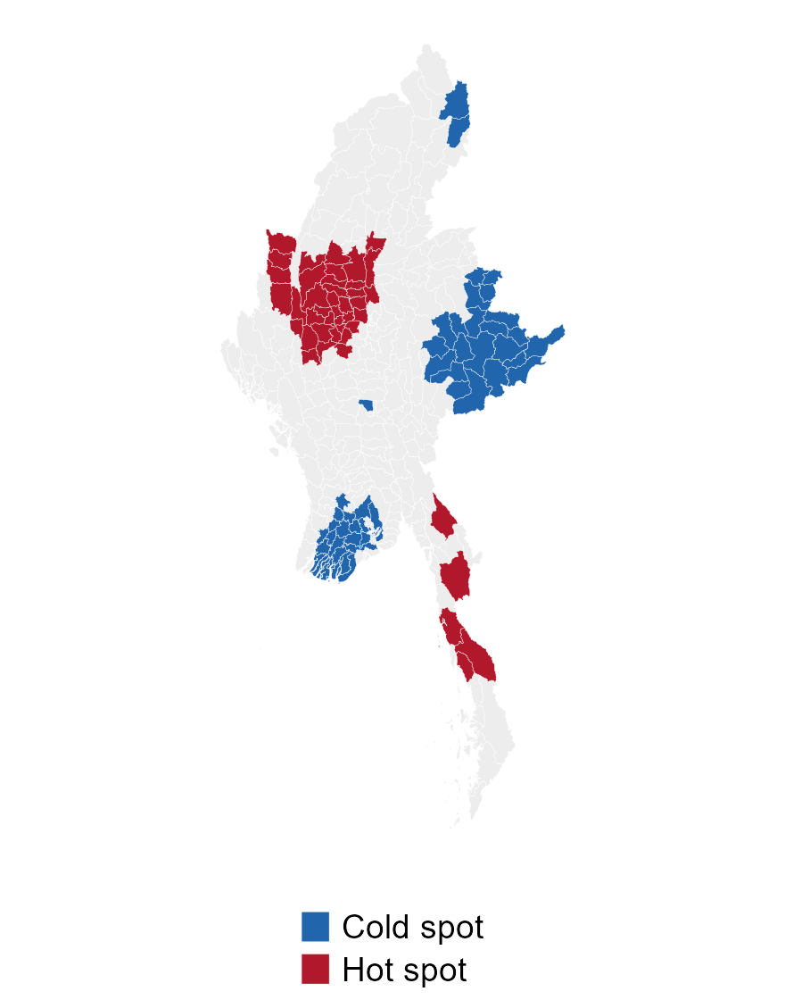
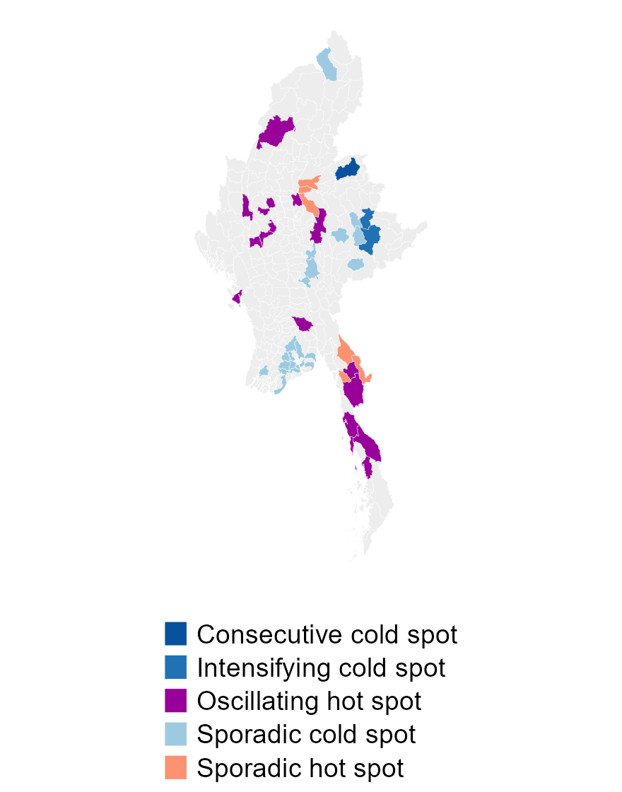
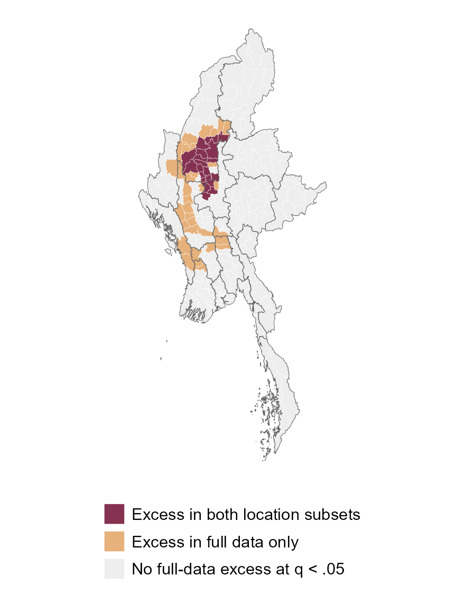

```{r}
#| include: false
source('analysis/run_analysis.R')
source('analysis/report_helpers.R')
library(dplyr)
d<-readRDS('outputs/prepared.rds');s<-readRDS('outputs/statistics.rds');f<-readRDS('outputs/figure_data.rds')
e<-readRDS('outputs/extensions.rds')
h<-readRDS('outputs/evidence_audit.rds')
severity_validation<-readRDS('outputs/severity_validation.rds')
global_moran<-readRDS('outputs/global_moran.rds')
fmt<-function(x)format(x,big.mark=',',scientific=FALSE,trim=TRUE)
ev<-s$static %>% filter(variable=='events');fa<-s$static %>% filter(variable=='fatalities')
ee<-s$ehsa %>% filter(variable=='events');ef<-s$ehsa %>% filter(variable=='fatalities')
```

## Study question and data

Where does recorded conflict cluster, and where does clustering change over time?

- **330 townships**, MIMU v9.4 boundaries.
- **57 months**, January 2021 to September 2025.
- **`r fmt(nrow(d$assigned))` assigned events**, **`r fmt(sum(d$assigned$fatalities))` reported fatalities**.
- Battles, explosions/remote violence and violence against civilians.

**Methods:** Global Moran's I uses 9,999 permutations, local tests 4,999 and space-time Gi* 999, followed by Mann-Kendall trends.

**Overall association:** I = **`r sprintf('%.3f',global_moran$results$I[global_moran$results$variable=='events'])`** for events and **`r sprintf('%.3f',global_moran$results$I[global_moran$results$variable=='fatalities'])`** for fatalities. Both pass the two-test Holm threshold (p = `r sprintf('%.4f',max(global_moran$results$holm_p))`).

Main maps show **p < 0.05**. Data-quality alternatives leave adjusted static hotspot sets unchanged.

## Recorded burden through time

{height=430}

Peak event month: **`r format_month_en(f$monthly$month[which.max(f$monthly$events)])`**, with **`r fmt(max(f$monthly$events))`** events. The 2025 series ends in September.

## Event-count clusters and outliers

:::: {.columns}
::: {.column width="58%"}
{height=540}
:::
::: {.column width="42%"}

**`r sum(ev$lisa=='High-High')` High-High townships**

**`r sum(ev$lisa %in% c('High-Low','Low-High'))` spatial outliers**

High-High means a high recorded total surrounded by high totals. An outlier differs from its neighbours.

Grey areas are not significant under this test. They are not established safe areas.

Sagaing contains **`r sum(ev$lisa=='High-High' & d$townships$ST=='Sagaing')` of `r sum(ev$lisa=='High-High')`** High-High townships under the Local Moran test shown here.
:::
::::

## Reported-fatality concentrations

:::: {.columns}
::: {.column width="58%"}
{height=540}
:::
::: {.column width="42%"}

**`r sum(fa$hotspot=='Hot spot')` nominal hot spots**

**`r sum(ev$hotspot=='Hot spot' & fa$hotspot=='Hot spot')` overlap with event-count hot spots**

Fatality totals complement event frequency but can be dominated by severe incidents. Recorded fatalities are estimates, not a verified death toll.
:::
::::

## Emerging event-count patterns

:::: {.columns}
::: {.column width="60%"}
{height=540}
:::
::: {.column width="40%"}

**`r sum(ee$map_class!='Not displayed')` displayed township patterns**

Colour requires a recognised hot/cold pattern and **Mann-Kendall p < 0.05**.

The time neighbourhood includes the current and previous month. Sporadic patterns require a significant final month under the cited Pro 3.4 definitions.

Hot patterns are mainly **`r sum(ee$map_class=='Sporadic hot spot')` sporadic** and **`r sum(ee$map_class=='Oscillating hot spot')` oscillating** townships.
:::
::::

## Local change against the national trend

```{r}
#| results: asis
a<-h$case_comparison %>% filter(variable=='events') %>% arrange(case_id)
knitr::kable(a %>% transmute(Township=township,`2024 events`=local_2024,`2025 events`=local_2025,
 `2024 share %`=share_2024,`2025 share %`=share_2025),digits=2)
```

January-September comparisons: national events decline **12.3%**, while Kawkareik and Nawnghkio gain both events and national share. Monywa and Myingyan lose event share.

Fatality counts can fall while shares rise: Nawnghkio falls from 91 to 70 fatalities, but its share rises from 0.54% to 0.59% during a larger national decline.

This descriptive benchmark complements the report's four profiles. It does not remove national trends from the full-period EHSA or estimate population risk.

## Robustness changes the strength of evidence

```{r}
knitr::kable(e$temporal_summary %>% select(variable,displayed,supported_displayed),
 col.names=c('Outcome','Displayed trend-patterns','Also pass BH and all block checks'))
```

Additional temporal support requires MK BH q < 0.05 and all 3-, 6- and 12-month block p-values < 0.05. Long-block resolution is limited.

BH-adjusted space-time bins leave **`r sum(e$comparison$variable=='events' & e$comparison$scenario=='BH-adjusted space-time bins' & e$comparison$map_class!='Not displayed')` event** and **`r sum(e$comparison$variable=='fatalities' & e$comparison$scenario=='BH-adjusted space-time bins' & e$comparison$map_class!='Not displayed')` fatality** patterns displayed.

**Global sensitivity:** Positive Moran association survives **`r sum(global_moran$sensitivity$positive_supported)`/8** comparisons of raw/log1p totals and queen/symmetric six-neighbour weights (eight-test Holm p = `r sprintf('%.4f',max(global_moran$sensitivity$holm_p_8))`). This supports overall association, not the individual EHSA labels.

**Overall concentration is stable across these checks. Temporal labels remain sensitive.**

## Fatality severity after conditioning on events

:::: {.columns}
::: {.column width="54%"}
{height=540}
:::
::: {.column width="46%"}

**`r sum(e$severity$excess)` baseline excess-severity neighbourhoods** at BH q < 0.05. Three repeat seeds yield **`r min(severity_validation$seed_families$supported_neighbourhoods[severity_validation$seed_families$scenario=='All assigned events'])` to `r max(severity_validation$seed_families$supported_neighbourhoods[severity_validation$seed_families$scenario=='All assigned events'])`**, so the total is simulation-sensitive.

**`r sum(e$severity$excess & e$severity$precise_excess)` also pass** in the precise-location subset.

The simulation shuffles fatality marks within month and type while holding event locations fixed.

**Kyunhla, Kawlin and Taze** lie outside ordinary adjusted count hotspots. All **`r sum(severity_validation$deletion_cases$supported)` of `r nrow(severity_validation$deletion_cases)` case/sample checks** retain support across repeated seeds and after deleting each neighbourhood's largest-fatality record.

Each new run uses 1,999 permutations and BH over all 330 neighbourhoods. Overlap, reporting bias and correlated incidents remain limitations.
:::
::::

## Peace-building implications and limits

- Nawnghkio gains event share and passes the additional trend checks. Kawkareik also gains share, but its longer-block result requires caution.
- Monywa illustrates why a grey EHSA area can still have a high accumulated burden.
- Combine recorded conflict with displacement, access and service information before allocating assistance.
- Treat low counts cautiously where reporting coverage may be weak.

The results support retrospective humanitarian discussion. They do not establish safe routes or operational targets.

## Sources and reproducibility

[Technical report](Take-Home_Ex02.qmd) documents processing, parameters, results and runnable R scripts.

[GitHub repository: JUNCHENLI2026/ISSS626_GAA](https://github.com/JUNCHENLI2026/ISSS626_GAA).

- ACLED event extract supplied for this exercise; [Codebook](https://acleddata.com/methodology/acled-codebook).
- [MIMU GeoNode](https://geonode.themimu.info/), township boundaries v9.4.
- [spdep](https://r-spatial.github.io/spdep/), local spatial tests.
- [Esri Pro 3.4 EHSA definitions](https://pro.arcgis.com/en/pro-app/3.4/tool-reference/space-time-pattern-mining/learnmoreemerging.htm), including the terminal-bin rule.

::: {.small-note}
AI assistance was used to optimise parts of the R code and fix some bugs.
:::
